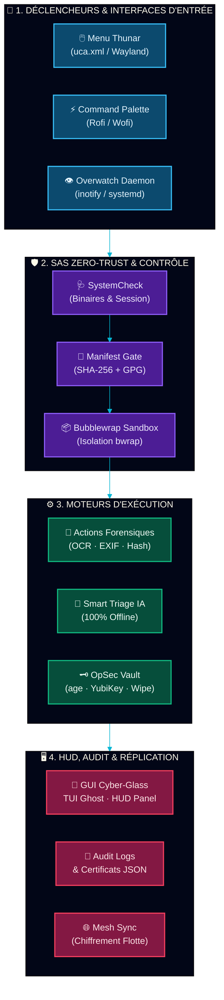
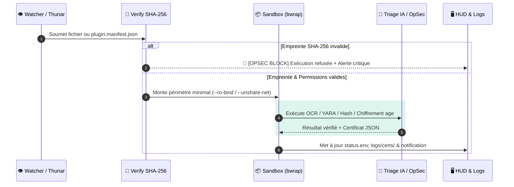

<div align="center">

<!-- ═══════════════════════════════════════════════════════════════════════ -->
<!--                         BANNIÈRE HÉROÏQUE v4.0.0                        -->
<!-- ═══════════════════════════════════════════════════════════════════════ -->


<!-- TERMINAL ANIMÉ TENDANCE -->
<a href="#sommaire">
  
</a>

<br />

<!-- MUR DE BADGES NÉON -->
<p>
  
  
  
  
  
  
</p>

</div>

---

<a id="sommaire"></a>

## 🧭 𝗖𝗘𝗡𝗧𝗥𝗘 𝗗𝗘 𝗡𝗔𝗩𝗜𝗚𝗔𝗧𝗜𝗢𝗡 (𝗦𝗼𝗺𝗺𝗮𝗶𝗿𝗲)

<div align="center">

| # | Module & Section | Description Opérationnelle | Accès Rapide |
| :-: | :--- | :--- | :---: |
| `01` | **🧬 Genèse & Évolution** | Histoire complète de la `v1.0.0` à la `v4.0.0` | [**Explorer ➔**](#genese) |
| `02` | **🚀 Nouveautés v4.0.0** | IA locale offline, Sandbox `bwrap`, Mesh Sync & Command Palette | [**Découvrir ➔**](#nouveautes) |
| `03` | **🎨 Thèmes & Identité** | 4 profils visuels tendance (*Overwatch*, *Cyberpunk*, *Obsidian*, *Nord*) | [**Aperçu ➔**](#themes) |
| `04` | **🧠 Architecture & Flux** | Schéma système Zero-Trust + Diagramme de séquence temps réel | [**Schémas ➔**](#architecture) |
| `05` | **🛡️ Protocole OpSec** | Chiffrement matériel, Wipe certifié & Audit SHA-256/GPG | [**Sécurité ➔**](#securite) |
| `06` | **📦 Arborescence & Stack** | Structure modulaire complète du dépôt `Thunar-xfce` | [**Fichiers ➔**](#structure) |
| `07` | **⚙️ Déploiement & CLI** | Installation `.deb`, commandes TUI/GUI/HUD & raccourcis clavier | [**Installer ➔**](#deploiement) |

</div>

<details>
<summary><b>⚡ Accès Express — Badges de saut rapide & Fiche technique (cliquer pour déplier)</b></summary>

<br />

<p align="center">
  <a href="#genese"></a>
  <a href="#nouveautes"></a>
  <a href="#themes"></a>
  <a href="#architecture"></a>
  <a href="#securite"></a>
  <a href="#structure"></a>
  <a href="#deploiement"></a>
</p>

- **Systèmes cibles :** Debian 12/13, Ubuntu/Xubuntu, Kali XFCE, Linux Mint XFCE
- **Sessions supportées :** X11 (`xclip`, `xfce4-panel`) & Wayland (`wl-clipboard`, `labwc`, `wofi`)
- **Moteurs requis :** `bash >= 5.0`, `jq`, `inotify-tools`, `bubblewrap`, `gnupg` / `age`

</details>

---

> [!IMPORTANT]
> **Statut : `v4.0.0 "AEGIS NEXUS"`** — Evolution majeure du projet : d'un simple pack d'actions Thunar (`v1.0`) à une **plateforme souveraine Zero-Trust**, sandboxée par namespaces Linux, assistée par **IA locale 100% hors-ligne** et synchronisable sur toute une flotte Debian/XFCE.

---

<a id="genese"></a>

## 🧬 𝗚𝗘𝗡𝗘̀𝗦𝗘 & 𝗘́𝗩𝗢𝗟𝗨𝗧𝗜𝗢𝗡 (`v1.0.0` ➔ `v4.0.0`)

```mermaid
%%{init: {
  'theme': 'base',
  'themeVariables': {
    'primaryColor': '#0f172a',
    'primaryTextColor': '#f8fafc',
    'primaryBorderColor': '#06b6d4',
    'lineColor': '#10b981',
    'fontFamily': 'JetBrains Mono, monospace'
  }
}}%%
flowchart LR
    V10["🚀 v1.0.0<br/>Fondation<br/>Actions · TUI · .deb"] --> V11["🎨 v1.1.0<br/>Thème Tactique<br/>Bannière & Couleurs"]
    V11 --> V12["🔬 v1.2.0<br/>Forensique Pro<br/>OCR · Metadata · Hash"]
    V12 --> V20["🖥️ v2.0.0<br/>Interface GUI<br/>& Docs Complètes"]
    V20 --> V30["📡 v3.0.0<br/>OVERWATCH<br/>Daemon · OpSec · SHA256"]
    V30 --> V4A["🧠 v4.0-alpha<br/>Triage IA Offline<br/>& YARA Scanner"]
    V4A --> V4B["🔒 v4.0-beta<br/>Sandbox bwrap<br/>Zero-Trust Plugins"]
    V4B --> V40["⚡ v4.0.0<br/>AEGIS NEXUS<br/>Mesh Sync · HUD v4"]

    classDef era1 fill:#064e3b,stroke:#10b981,stroke-width:2px,color:#ecfdf5;
    classDef era2 fill:#1e3a8a,stroke:#38bdf8,stroke-width:2px,color:#e0f2fe;
    classDef era3 fill:#4c1d95,stroke:#8b5cf6,stroke-width:2px,color:#ede9fe;
    classDef era4 fill:#831843,stroke:#f43f5e,stroke-width:2px,color:#ffe4e6;
    classDef apex fill:#020617,stroke:#06b6d4,stroke-width:3px,color:#67e8f9;

    class V10,V11,V12 era1;
    class V20 era2;
    class V30 era3;
    class V4A,V4B era4;
    class V40 apex;
```



| Version | Nom de Code | Apport Majeur | État |
| :--- | :--- | :--- | :---: |
| **`v1.0.0`** | *Edition Tactique* | Actions Thunar, TUI *Ghost Recon*, `SystemCheck`, `PluginManager`, package `.deb` | `🟢 STABLE` |
| **`v1.1.0`** | *Camo Visual* | Thème graphique militaire, palette ANSI & bannière console | `🟢 STABLE` |
| **`v1.2.0`** | *Forensic Ops* | OCR multi-langues, nettoyage EXIF/métadonnées, hashing multi-algos | `🟢 STABLE` |
| **`v2.0.0`** | *Command Desk* | Interface GUI complète, documentation structurée & workflows CI/CD | `🟢 STABLE` |
| **`v3.0.0`** | *Overwatch* | Module `security/` (`age`/`GPG`/`wipe`), daemon `inotify`, plugins SHA-256, applet HUD | `🟢 STABLE` |
| **`v4.0.0`** | ***AEGIS NEXUS*** | **Sandbox `bwrap` Zero-Trust, IA locale offline, Command Palette & Mesh Sync** | `⚡ ACTUEL` |

---

<a id="nouveautes"></a>

## 🚀 𝗡𝗢𝗨𝗩𝗘𝗔𝗨𝗧𝗘́𝗦 & 𝗖𝗔𝗣𝗔𝗖𝗜𝗧𝗘́𝗦 `v4.0.0`

```diff
+ [SANDBOX]  Isolation stricte des plugins et scripts via Bubblewrap (bwrap) sans réseau par défaut
+ [LOCAL-AI] Triage & renommage intelligent 100% hors-ligne (OCR + heuristiques / Ollama local optionnel)
+ [THREAT]   Inspection MIME réelle vs extension + analyse entropie & règles YARA en quarantaine
+ [PALETTE]  Command Palette instantanée (Rofi / Wofi) compatible X11 & Wayland via raccourci global
+ [KEYVAULT] Support matériel YubiKey / FIDO2 pour déverrouillage age & coffres LUKS2
+ [MESH]     Synchronisation chiffrée des profils, règles Overwatch & logs d'audit entre postes
+ [THEMING]  Moteur multi-thèmes à chaud synchronisé entre TUI, GUI, notifications et applet HUD
```

<details>
<summary><b>🔬 Zoom technique sur les 4 moteurs de la v4.0.0 (cliquer pour déplier)</b></summary>

<br />

1. **🔒 Sandbox Zero-Trust (`sandbox/bwrap-runner.sh`)**
   - Chaque plugin signé (`plugin.manifest.json`) est exécuté dans un espace isolé (`--ro-bind`, `--unshare-net`, `--tmpfs /tmp`).
   - Impossible pour un plugin de lire `~/.ssh`, `~/.gnupg` ou d'ouvrir un socket réseau sans autorisation explicite validée par l'opérateur.
2. **🧠 Triage Sémantique Offline (`ai/smart-triage.sh`)**
   - Analyse le contenu extrait (OCR / texte brut / métadonnées) pour classer automatiquement factures, contrats, logs ou captures dans des dossiers cibles **sans jamais envoyer un octet sur Internet**.
3. **⚡ Command Palette Tactique (`gui/command-palette.sh`)**
   - Lanceur instantané en overlay (`rofi` sous X11 / `wofi` sous Wayland) donnant accès en moins de `200ms` à toutes les actions, plugins et statuts du daemon.
4. **🌐 Mesh Fleet Sync (`sync/mesh-sync.sh`)**
   - Exporte et réplique un profil complet (thème, `uca.xml`, règles `overwatch.conf`, manifestes) sous forme d'archive chiffrée `age` ou de paquet `.deb` prêt à déployer.

</details>

---

<a id="themes"></a>

## 🎨 𝗧𝗛𝗘̀𝗠𝗘𝗦 𝗧𝗘𝗡𝗗𝗔𝗡𝗖𝗘 & 𝗜𝗗𝗘𝗡𝗧𝗜𝗧𝗘́ 𝗩𝗜𝗦𝗨𝗘𝗟𝗟𝗘

La `v4.0.0` introduit un sélecteur de thème unifié (<kbd>thunar-xfce --theme &lt;nom&gt;</kbd>) qui harmonise simultanément la **TUI**, la **GUI**, les **notifications** et l'**applet `xfce4-panel`** :

| Thème | Ambiance | Palette de Couleurs | Usage Recommandé |
| :--- | :--- | :--- | :--- |
| **`overwatch`** | 🟩 *Tactique Émeraude* |    | Mode par défaut, contraste élevé |
| **`cyberpunk`** | 🌸 *Neon Night City* |    | Postes créatifs & HUD néon |
| **`obsidian`** | 🖤 *Stealth Black-Ops* |    | Discrétion maximale & faible luminosité |
| **`nord-frost`** | ❄️ *Arctic Command* |    | Environnements XFCE Nord / Catppuccin |

> [!TIP]
> Pour basculer de thème à la volée sans redémarrer Thunar : `thunar-xfce --theme cyberpunk && thunar-xfce --hud-refresh`.

---

<a id="architecture"></a>

## 🧠 𝗔𝗥𝗖𝗛𝗜𝗧𝗘𝗖𝗧𝗨𝗥𝗘 & 𝗙𝗟𝗨𝗫 𝗭𝗘𝗥𝗢-𝗧𝗥𝗨𝗦𝗧

### 1️⃣ Vue Topologique Complète (`v4.0.0`)



### 2️⃣ Séquence d'Exécution Zero-Trust d'un Fichier / Plugin



---

<a id="securite"></a>

## 🛡️ 𝗣𝗥𝗢𝗧𝗢𝗖𝗢𝗟𝗘 𝗢𝗣𝗦𝗘𝗖 & 𝗭𝗘𝗥𝗢-𝗧𝗥𝗨𝗦𝗧

> [!CAUTION]
> **Règle d'or AEGIS :** Aucun plugin tiers ne s'exécute sans empreinte `SHA-256` valide, et toute destruction sécurisée (`wipe`) est **irréversible**. Les certificats générés dans `logs/certs/` font foi d'audit.

> [!WARNING]
> Le triage IA (`ai/smart-triage.sh`) fonctionne **exclusivement en local**. Vérifie que la permission `"network": false` est bien conservée dans tes manifestes de plugins sensibles.

```json
{
  "schema": "4.0",
  "id": "forensic-ocr-triage",
  "version": "4.0.0",
  "entry": "plugin.sh",
  "sha256": "e3b0c44298fc1c149afbf4c8996fb92427ae41e4649b934ca495991b7852b855",
  "sandbox": {
    "engine": "bubblewrap",
    "unshare_net": true,
    "readonly_home": true,
    "allow_paths": ["~/Documents/Triage"]
  },
  "permissions": {
    "fs_read": true,
    "fs_write": true,
    "network": false,
    "pkexec": false
  }
}
```

---

<a id="structure"></a>

## 📦 𝗦𝗧𝗥𝗨𝗖𝗧𝗨𝗥𝗘 𝗠𝗢𝗗𝗨𝗟𝗔𝗜𝗥𝗘 `v4.5.0`
```text
ThunarLE/
├── 🤖 .github/                        ──► Workflows CI/CD (build, main, release), templates & SECURITY.md
│
├── ⚙️ src/                            ──► Code applicatif modulaire (regroupé par compatibilité)
│   ├── 🧭 lib/                        ──► Utilitaires partagés (path.sh — résolution racine & env)
│   ├── 🧩 thunar/                     ──► Couche Thunar & Extensions
│   │   ├── ⚡ actions/                ──► Actions Thunar (.desktop + actions/scripts/)
│   │   ├── 🔌 plugins/                ──► Loader, verify-plugin.sh (SHA-256), sign-plugin.sh & custom/
│   │   └── 🧬 extension/              ──► Extension native thunarx (v5.0 preview)
│   ├── 🖥️ ui/                         ──► Couche Interfaces (X11 / Wayland / XFCE)
│   │   ├── 🕶️ tui/                    ──► Console "Ghost Recon", PluginManager.sh & SystemCheck.sh
│   │   ├── 🪟 gui/                    ──► Dashboard Cyber-Glass, wayland-compat.sh & Command Palette
│   │   └── 🟩 hud/                    ──► Applet temps réel xfce4-panel (genmon)
│   ├── 🛡️ opsec/                      ──► Couche Sécurité & Isolation Zero-Trust
│   │   ├── 🔐 security/               ──► OpSec Crypt (age/GPG), Wipe certifié & Quarantaine
│   │   └── 📦 sandbox/                ──► Runner isolé Bubblewrap (bwrap-runner.sh)
│   └── 📡 engine/                     ──► Couche Services & Intelligence Autonome
│       ├── 👁️ daemon/                 ──► Service systemd --user & watchers inotify
│       ├── 🧠 ai/                     ──► Moteur de triage sémantique offline & règles YARA
│       └── 🌐 sync/                   ──► Réplication chiffrée Mesh entre postes Debian/XFCE
│
├── 🎛️ config/                         ──► Configurations (action, plugins, thunar, overwatch, theme.confs)
├── 📜 var/                            ──► Données runtime isolées du code source
│   └── 🗂️ logs/                       ──► Journaux (thunar-xfce.log) & certificats wipe JSON (certs/)
├── 📦 packaging/                      ──► Distribution & déploiement flotte
│   └── 🐧 debian/                     ──► Packaging .deb (DEBIAN/{control,postinst,postrm} & opt/)
├── 📚 docs/                           ──► Manuels, architecture, CHANGELOG, ROADMAP & releases/
├── 🧪 tests/                          ──► Tests automatisés (bats-core & fixtures CI)
│
├── 📖 README.md                       ──► Vitrine principale & documentation d'entrée
├── 🏷️ VERSION.md                      ──► Numéro de version actif (4.5.0)
├── 🚀 install.sh                      ──► Déploiement tout-en-un & vérification pré-vol
└── ⚡ thunar-xfce.sh                  ──► Point d'entrée unifié CLI / TUI / GUI / Daemon
```

<a id="deploiement"></a>

## ⚙️ 𝗗𝗘́𝗣𝗟𝗢𝗜𝗘𝗠𝗘𝗡𝗧 & 𝗖𝗢𝗠𝗠𝗔𝗡𝗗𝗘𝗦 𝗥𝗔𝗣𝗜𝗗𝗘𝗦

> [!NOTE]
> Les workflows CI/CD (`.github/workflows/main.yml` et `build.yml`) valident automatiquement à chaque commit la syntaxe ShellCheck, l'anti-falsification `SHA-256`, les garde-fous `OpSec` et la construction du paquet `.deb`.

### 1️⃣ Installation Express (Debian / Ubuntu / XFCE)

```bash
# Cloner le dépôt officiel
git clone https://github.com/TON-USER/Thunar-xfce.git
cd Thunar-xfce

# Déploiement automatisé + installation des dépendances + SystemCheck
sudo bash install.sh
```

### 2️⃣ Matrice de Commandes & Raccourcis

| Interface / Module | Commande | Rôle |
| :--- | :--- | :--- |
| **🕶️ TUI Ghost Recon** | <kbd>./thunar-xfce.sh --tui</kbd> | Console tactique complète & gestionnaire de plugins |
| **🖥️ GUI Cyber-Glass** | <kbd>./thunar-xfce.sh --gui</kbd> | Tableau de bord graphique X11 / Wayland |
| **⚡ Command Palette** | <kbd>./thunar-xfce.sh --palette</kbd> | Lanceur instantané Rofi / Wofi (recommandé sur <kbd>Super</kbd>+<kbd>Space</kbd>) |
| **🩺 Audit Système** | <kbd>./thunar-xfce.sh --check</kbd> | Exécute `SystemCheck` (binaires, sandbox `bwrap`, session) |
| **🎨 Changer de Thème** | <kbd>./thunar-xfce.sh --theme cyberpunk</kbd> | Applique le thème sur TUI, GUI & HUD |
| **📡 Daemon Overwatch** | <kbd>systemctl --user status thunar-overwatch</kbd> | Supervision temps réel des dossiers surveillés |

---

<div align="center">


**🟩 𝗧𝗛𝗨𝗡𝗔𝗥-𝗫𝗙𝗖𝗘 `v4.0.0 "AEGIS NEXUS"` — *Conçu pour la précision, isolé pour la souveraineté.***
<br />
<sub>
  ⬆️ <a href="#sommaire"><b>Retour au Centre de Navigation</b></a> &nbsp;•&nbsp;
  <a href="#genese"><b>Genèse v1➜v4</b></a> &nbsp;•&nbsp;
  <a href="#architecture"><b>Architecture</b></a> &nbsp;•&nbsp;
  <a href="#deploiement"><b>Installation</b></a> ⬆️
</sub>

</div>
