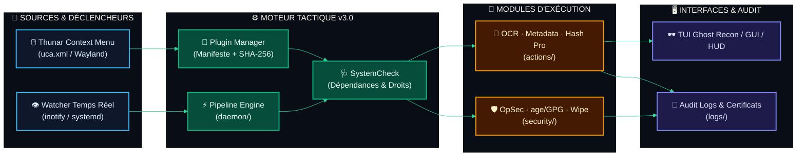

<div align="center">

<!-- BANNIÈRE TACTIQUE -->


<br />

### `⚡ POSTE DE COMMANDEMENT LINUX · AUTOMATISATION · OPSEC · XFCE ⚡`

<p>
  
  
  
  
</p>

<p>
  <sub>
    <b><a href="#-mission">🎯 Mission</a></b> &nbsp;•&nbsp;
    <b><a href="#-capacités-opérationnelles">🛠️ Capacités</a></b> &nbsp;•&nbsp;
    <b><a href="#-architecture-overwatch">🧠 Architecture</a></b> &nbsp;•&nbsp;
    <b><a href="#-structure-du-dépôt">📦 Structure</a></b> &nbsp;•&nbsp;
    <b><a href="#-déploiement-rapide">⚙️ Installation</a></b> &nbsp;•&nbsp;
    <b><a href="#-protocole-de-sécurité">🛡️ Sécurité</a></b> &nbsp;•&nbsp;
    <b><a href="#-roadmap-tactique">🚀 Roadmap</a></b>
  </sub>
</p>

</div>

---

> [!IMPORTANT]
> **Statut : `v3.0.0 "Overwatch"`** — Passage d’un gestionnaire d’actions manuelles à une **suite autonome** intégrant watchers temps réel (`inotify`), chiffrement OpSec (`age`/`GPG`), plugins signés et compatibilité **XFCE / Wayland**.

---

## 🎯 Mission

Transformer **Thunar** en un véritable **centre d’opérations Linux** alliant rapidité d’exécution, sécurité cryptographique et esthétique militaire :

| Axe | Objectif Opérationnel | Interface |
| :--- | :--- | :--- |
| 🕶️ **Commandement** | Pilotage clavier ultra-rapide et monitoring visuel | **TUI Ghost Recon** + **GUI Tactique** |
| 🔬 **Analyse & Forensique** | OCR, extraction/nettoyage de métadonnées, hashing avancé | **Actions Thunar** (`uca.xml`) |
| 📡 **Automatisation** | Surveillance de dossiers et pipelines déclenchés à la volée | **Daemon `inotify`** (`systemd --user`) |
| 🔐 **OpSec & Intégrité** | Chiffrement, effacement certifié, quarantaine & plugins signés | **Module `security/`** + **SystemCheck** |

---

## 🛠️ Capacités Opérationnelles

```diff
+ [CORE]    Actions Thunar avancées : OCR multi-langues, Metadata Stripper, Hash Pro (SHA-256/512/BLAKE3)
+ [UI/UX]   Double interface synchronisée : TUI "Ghost Recon" + GUI Tactique complète
+ [HUD]     Applet temps réel pour xfce4-panel & support natif XFCE 4.20+ / Wayland
+ [DAEMON]  Watchers automatisés (inotify + systemd --user) avec chaînes de règles
+ [OPSEC]   Chiffrement rapide (age / GPG), Wipe certifié (shred + log horodaté), Quarantaine
+ [PLUGINS] Gestionnaire modulaire avec manifeste de permissions & signature SHA-256/GPG
+ [DEPLOY]  SystemCheck Mode, journalisation centralisée & export de profils flotte (.deb)
```

<details>
<summary><b>📂 Aperçu détaillé des modules v3.0 (cliquer pour déplier)</b></summary>

<br />

1. **⚡ Pipelines Watchers (`daemon/`)**
   - Surveille automatiquement `~/Téléchargements`, `~/Vault` ou tout répertoire configuré.
   - Exemple : *PDF entrant* → `OCR auto` → `renommage horodaté` → `log d'audit`.
2. **🔐 Coffre & Destruction Sécurisée (`security/`)**
   - Chiffrement/déchiffrement direct depuis le menu contextuel Thunar (`age` / `GPG`).
   - Effacement multi-passes avec génération d’un **certificat d’audit** dans `logs/`.
3. **🧩 SDK Plugins Signés (`plugins/`)**
   - Chaque module embarque un `plugin.manifest.json` déclarant ses droits (lecture, écriture, réseau, `pkexec`).

</details>

---

## 🧠 Architecture Overwatch



---

## 📦 Structure du Dépôt

```text
Thunar-xfce/
├── ⚡ actions/     ──► Actions Thunar (uca.xml, OCR, Metadata, Hash Pro)
├── 📡 daemon/      ──► Watchers temps réel & moteur de pipelines (v3.0)
├── 🧩 plugins/     ──► Modules additionnels & manifestes de permissions
├── 🕶️ tui/         ──► Interface militaire "Ghost Recon"
├── 🖥️ gui/         ──► Interface graphique tactique & éditeur de règles
├── 🔐 security/    ──► Modules OpSec : chiffrement, quarantaine & wipe
├── ⚙️ config/      ──► Profils tactiques & configuration globale
├── 📜 logs/        ──► Journalisation & certificats d'audit horodatés
├── 📦 debian/      ──► Packaging .deb & déploiement multi-postes
└── 🚀 install.sh   ──► Script d'installation & SystemCheck automatisé
```

---

## ⚙️ Déploiement Rapide

### 1️⃣ Installation standard (Debian / Ubuntu / XFCE)

```bash
# Cloner le poste de commandement
git clone https://github.com/TON-USER/Thunar-xfce.git
cd Thunar-xfce

# Lancer le déploiement automatisé + SystemCheck
sudo bash install.sh
```

### 2️⃣ Commandes de contrôle rapides

| Action | Commande | Rôle |
| :--- | :--- | :--- |
| **Lancer la TUI** | <kbd>thunar-xfce --tui</kbd> | Ouvre l’interface console *Ghost Recon* |
| **Lancer la GUI** | <kbd>thunar-xfce --gui</kbd> | Ouvre le tableau de bord tactique |
| **Audit système** | <kbd>thunar-xfce --check</kbd> | Vérifie dépendances, droits & intégrité |
| **Statut Daemon** | <kbd>systemctl --user status thunar-overwatch</kbd> | Contrôle les watchers `inotify` |

> [!TIP]
> Après l’installation, redémarre le démon Thunar avec `thunar -q && thunar --daemon &` pour charger instantanément toutes les nouvelles actions contextuelles.

---

## 🛡️ Protocole de Sécurité

> [!CAUTION]
> Les opérations de **destruction sécurisée (`wipe`)** et de **quarantaine** modifient les fichiers de manière irréversible. Consulte systématiquement `logs/` après exécution.

| Contrôle | Mécanisme implémenté | Statut |
| :--- | :--- | :---: |
| **Moindre privilège** | Permissions strictes & manifestes déclaratifs par plugin | `🟢 ACTIF` |
| **Intégrité logicielle** | Vérification cryptographique `SHA-256` / `GPG` avant activation | `🟢 ACTIF` |
| **Traçabilité forensique** | Logs dédiés + certificats d'effacement horodatés (`logs/`) | `🟢 ACTIF` |
| **Pré-vol matériel** | Contrôle des binaires requis via **SystemCheck Mode** | `🟢 ACTIF` |

---

## 🚀 Roadmap Tactique

```mermaid
%%{init: {
  'theme': 'base',
  'themeVariables': {
    'primaryColor': '#0f172a',
    'primaryTextColor': '#f8fafc',
    'primaryBorderColor': '#10b981',
    'lineColor': '#10b981',
    'fontFamily': 'monospace'
  }
}}%%
flowchart LR
    V10["✅ v1.0.0<br/>Fondation & TUI<br/>Actions + .deb"] --> V11["✅ v1.1.0<br/>Thème Graphique<br/>Militaire"]
    V11 --> V12["✅ v1.2.0<br/>OCR · Metadata<br/>Hashing Pro"]
    V12 --> V20["✅ v2.0.0<br/>Interface GUI<br/>Complète"]
    V20 --> V3A["🚧 v3.0-alpha<br/>Module security/<br/>age · GPG · Wipe"]
    V3A --> V3B["⏳ v3.0-beta<br/>Service daemon/<br/>Watchers inotify"]
    V3B --> V3R["⏳ v3.0-rc<br/>Plugins signés<br/>Manifeste + SHA256"]
    V3R --> V30["🎯 v3.0.0<br/>OVERWATCH<br/>HUD + Wayland + GUI"]

    classDef done fill:#064e3b,stroke:#10b981,stroke-width:2px,color:#ecfdf5;
    classDef wip fill:#451a03,stroke:#f59e0b,stroke-width:2px,color:#fef3c7;
    classDef next fill:#1e293b,stroke:#64748b,stroke-width:2px,color:#cbd5e1;
    classDef goal fill:#0f172a,stroke:#38bdf8,stroke-width:3px,color:#e0f2fe;

    class V10,V11,V12,V20 done;
    class V3A wip;
    class V3B,V3R next;
    class V30 goal;
```



<details>
<summary><b>📋 Journal des jalons v3.0 (Alpha → Release)</b></summary>

- [x] **v1.0 → v2.0** : Socle Thunar, TUI Ghost Recon, thème militaire, OCR/Hash, GUI complète.
- [ ] **v3.0-alpha** : Ajout de `security/` (chiffrement `age`/`gpg` + `shred` avec certificat dans `logs/`).
- [ ] **v3.0-beta** : Création du service `daemon/` (`inotifywait` piloté par `systemctl --user`).
- [ ] **v3.0-rc** : Déploiement de `plugin.manifest.json` + vérification `SHA-256` dans le Plugin Manager.
- [ ] **v3.0.0** : Intégration complète dans la GUI + applet `xfce4-panel` + support Wayland + `.deb` mis à jour.

</details>

---

<div align="center">

**🟩 Thunar-xfce — *Conçu pour la précision, durci pour le terrain.***
<br />
<sub>⬆️ <a href="#-mission">Retour au poste de commandement</a> ⬆️</sub>

</div>
